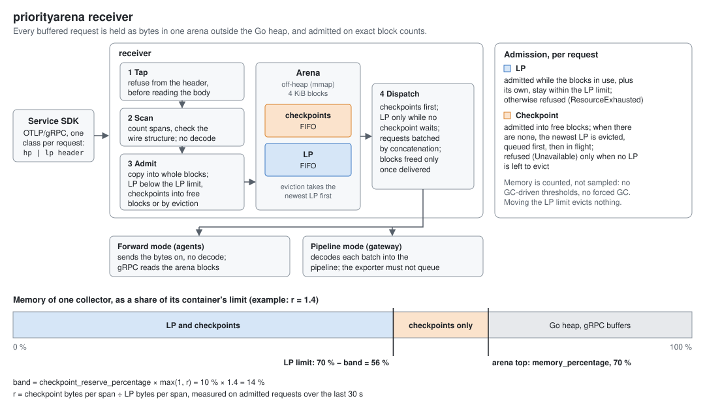

# From the priority processor to the priority arena receiver

The priority arena receiver replaces the collector pipeline that used to protect checkpoint spans
(`priority` processor, `batch` processor and an exporter queue). It holds every buffered request as
raw bytes in one arena outside the Go heap, and decides admission on exact byte counts instead of
on the Go heap's size. On a 0.5-CPU, 256 MiB agent it carried 200k spans/s on 0.38 cores with no
loss, where the old pipeline saturated near 125k, and it refuses less ordinary data under
backpressure.



## The old pipeline

```
otlp receiver -> priority processor -> batch processor -> otlp exporter (sending queue)
```

* Every request was decoded into pdata on arrival, then queued twice: in the batch processor and in
  the exporter's sending queue.
* The priority processor's admission controller sampled `runtime.MemStats.Alloc` every 100 ms. That
  figure includes garbage the GC has not collected yet. The controller projected the next GC peak
  (about twice the live heap) and moved between states:
  * shed LP when the projection neared the soft line;
  * at the soft line, refuse everything, checkpoints included;
  * at the hard line, force a GC on every tick.
* Two further rules refused LP with no memory threshold at all: "a batch is waiting for a worker" and
  "an upstream collector reports checkpoints waiting".

What that cost, on a 256 MiB, 0.5-CPU agent:

* Decisions followed garbage, not data. LP was shed while the data held was a small fraction of the
  memory limit, and checkpoints were refused once garbage pushed the reading past the soft line.
* GC work grew with the load. pdata is many small objects per span, every one garbage once sent, and
  the forced GCs came on top. The agent hit its CPU limit at about 125k spans/s.
* At 200k spans/s the deployed pipeline lost 15 % of checkpoints and 69 % of LP. A 20 s gateway
  outage cost 9.7 % of checkpoints.

## The new receiver

```
priorityarena receiver (agents: forward the bytes; gateway: decode and call the exporter, no queue)
```

* **One arena.** A fixed region, mapped with `mmap` at start and split into 4 KiB blocks, holds every
  buffered request. Its bookkeeping is int32 arrays, so the GC neither scans nor counts it. The arena
  is the only place data waits; nothing after the receiver queues.
* **Exact admission.** Each request is admitted or refused before it is copied, on the blocks it
  needs:
  * LP is admitted while the blocks in use stay within the LP limit.
  * A checkpoint is admitted into free blocks. When there are none, it evicts the newest LP, queued
    first and then in flight. It is refused only when no LP is left.
* **Refusal before reading.** A gRPC tap refuses a request from its headers when its class is already
  over its limit, so refused requests cost almost nothing.
* **No decode on the agents.** A wire scan counts spans and checks structure without allocating.
  Agents forward the bytes as they are, and gRPC reads the arena blocks directly. Only the gateway
  decodes, one batch at a time, just before its exporter.
* **Checkpoints first.** Dispatch sends checkpoints before LP, and LP only while no checkpoint waits.
  Queued requests are batched by concatenating their bytes. A request leaves the arena only once it
  has been delivered; a retryable failure puts it back at the front of its queue.
* **LP limit from the span sizes (optional).** With `checkpoint_reserve_percentage`, the top of the
  arena is a band for checkpoints alone, sized as reserve × max(1, r), where r is checkpoint bytes per
  span ÷ LP bytes per span over the last 30 s. The band then holds about as many checkpoint spans as
  the reserve would hold LP spans, so LP refused at the limit and checkpoints admitted into the band
  trade about span for span. Otherwise the LP limit is a fixed share (`lp_percentage`).

## What changed

| | Old pipeline | Priority arena receiver |
|---|---|---|
| What admission is decided on | Go heap allocation, sampled every 100 ms (includes garbage) | exact blocks in use, per request |
| Where data waits | batch processor, exporter queue, pdata on the heap | one off-heap arena |
| LP refused | near the soft line (projected), plus two rules with no memory threshold | when the blocks in use would pass the LP limit |
| Checkpoints refused | at the soft line, even with LP queued | only when no LP is left to evict |
| Room for checkpoints | the gap between LP shedding and the soft line, on the heap reading | everything LP holds, plus the room above the LP limit |
| Garbage collection | pdata per span; forced GCs at the hard line | a few small objects per request; no forced GC |
| Agent work per span | decode, re-encode | count, copy once, send the same bytes |
| Batching | batch processor (time or size) | concatenation of queued requests (`max_batch_*`, `linger`) |
| Order | FIFO per class after admission | checkpoints always ahead of LP |

## Measured

Synthetic load (16 SDK-like clients) against one 0.5-CPU, 256 MiB agent, same binary for both:

| | Old (deployed) | Arena |
|---|---|---|
| Agent CPU limit reached at | ~125k spans/s | not reached at 200k (0.38 cores) |
| At 200k spans/s: checkpoints / LP lost | 15.2 % / 69 % | 0 / 0 |
| GC cycles over the ramp, heap peak | 640, 49 MB | 293, 7 MB |
| Gateway slowed to 24k spans/s for 90 s: LP refused | 32 % | 17 % |
| Gateway refusing everything for 20 s: checkpoints refused | 9.7 % | 0 |

Size-based LP limit against a fixed 50 % limit (arena 70 % of the container, a third of the spans
checkpoints, r = 1.16, so LP refused at 58.4 %):

| | LP delivered, fixed | LP delivered, size-based | Checkpoints lost |
|---|---:|---:|---:|
| Gateway slowed to 24k spans/s for 90 s | 88.2 % | 90.5 % | 0 / 0 |
| The same with an extra 20k LP spans/s | 67.4 % | 69.3 % | 0 / 0 |
| Gateway refusing everything for 60 s | 69.9 % | 69.8 % | 0 / 0 |

In a full outage the arena's size bounds LP whatever the limit; the higher limit only moves part of
the LP loss from refusal to eviction after the acknowledgement.

DeathStarBench Social Network, eight agents and one ClickHouse gateway:

* Real work (application-bound at about 2,000 requests/s): neither pipeline refused anything. Agents
  used about 20 % less CPU per request with the arena.
* No work (the services only forward calls; about 145k spans/s at saturation): the old gateway refused
  5–8 % of all LP from about 6,000 requests/s. The arena refused nothing at any hop. Agents used
  20–40 % less CPU per request.

## Open issues

* The gateway (pipeline mode) uses the same or up to 20 % more CPU per request than the old gateway,
  so total collector CPU is about unchanged. This is not explained yet.
* A downstream that hangs (sends time out) instead of refusing has not been tested. It holds blocks in
  flight for up to `forward.timeout`.
* Requests must be priority-homogeneous, as the bridges SDK sends them.
