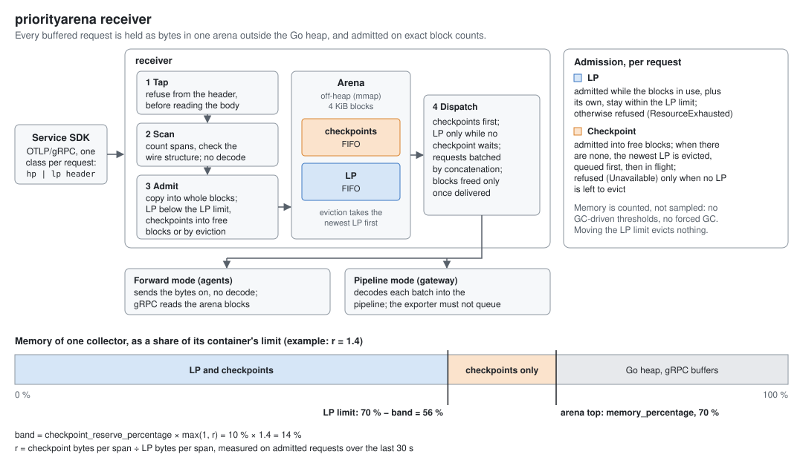

# Priority arena receiver

| Status | |
|---|---|
| Stability | development: traces |
| Component type | receiver (`priorityarena`) |

An OTLP/gRPC trace receiver for collectors that carry two classes of spans: **checkpoints**, which
must not be lost, and ordinary spans (**LP**, low priority), which may be shed under pressure. The
sender marks each request with a `bridges-priority: hp` (checkpoints) or `bridges-priority: lp`
gRPC header.

The receiver holds every buffered request as raw bytes in one fixed arena outside the Go heap. It
decides admission per request on exact byte counts, sends checkpoints first, and makes room for
checkpoints by evicting LP. Nothing after it in the pipeline should queue.



[DESIGN.md](DESIGN.md) explains the design and how it differs from the `priority` processor
pipeline it replaces, with measurements.

## How it works

* **Arena.** One region of `memory_mib` (or `memory_percentage` of the container's memory limit),
  mapped with `mmap` and `MAP_POPULATE`, so it is charged to the container once, at start. It is
  split into `block_kib` blocks. A request takes a chain of whole blocks, and all bookkeeping is
  int32 arrays the garbage collector never scans.
* **Before reading.** A gRPC tap refuses a request from its headers alone when its class is already
  over its limit, so a refused request is never read or copied.
* **Counting.** A wire scan counts the request's spans and checks its structure (lengths, wire types,
  nesting down to the spans) without allocating. Malformed requests are refused with
  `InvalidArgument`.
* **Admission**, per request, on the blocks it needs:
  * LP is admitted while the blocks in use, plus its own, stay within the LP limit.
  * A checkpoint is admitted into free blocks. If there are not enough, the newest queued LP
    requests are evicted until there are. If queued LP is not enough, LP being sent is evicted too:
    its send is cancelled and the checkpoint waits up to 500 ms for gRPC to hand the blocks back. A
    checkpoint is refused only when evicting all LP would still not make room.
* **LP limit.** Either fixed (`lp_percentage`, or `lp_limit_percentage` of the arena), or set from
  the span sizes with `checkpoint_reserve_percentage`. In that case the top of the arena is a band
  for checkpoints alone, of reserve × max(1, r), where r is the checkpoint bytes per span ÷ the LP
  bytes per span of the requests admitted over the last `size_window`. The band then holds about as
  many checkpoint spans as the reserve would hold LP spans. Moving the limit never evicts anything:
  LP above a lowered limit drains, and only new LP is refused.
* **Dispatch.** `workers` goroutines take queued requests, checkpoints first, and concatenate them up
  to `max_batch_spans` / `max_batch_kib` (concatenated OTLP requests form one valid request). LP is
  not sent while a checkpoint waits.
  * **Forward mode** (`forward.endpoint` set) sends the bytes to the next OTLP/gRPC server as they
    are, one class per send, with the `bridges-priority` header. gRPC reads the arena blocks
    directly. The pipeline's consumer is not used; give the pipeline a `nop` exporter.
  * **Pipeline mode** decodes each batch (checkpoints, then LP) and calls the pipeline. Turn off the
    exporter's `sending_queue` and use no `batch` processor. A batch that does not decode is retried
    request by request, and only the bad requests are dropped.
* **Failures.** A request stays in the arena until it is delivered. After a retryable error it goes
  back to the front of its queue and sends pause, with a backoff that doubles from
  `forward.backoff_initial` to `forward.backoff_max`. A refused checkpoint pauses every send, a
  refused LP request only LP.

LP is refused with `lp_refusal_code` (default `ResourceExhausted`, which the OTLP exporter does not
retry). Checkpoints are refused with `Unavailable`, which it retries.

## Configuration

| Field | Default | |
|---|---|---|
| `grpc` | `0.0.0.0:4317` | gRPC server settings, as for the OTLP receiver |
| `memory_mib` | 128 | Arena size. It is not Go heap: leave it out of `GOMEMLIMIT` |
| `memory_percentage` | 0 | Size the arena as this share (1–99) of the container's memory limit (cgroup v2 or v1) instead |
| `lp_percentage` | 0 | With `memory_percentage`: the share of the container's limit up to which LP is admitted; with `checkpoint_reserve_percentage`, only until the size ratio is known |
| `checkpoint_reserve_percentage` | 0 | With `memory_percentage`: set the LP limit from the span sizes. The band for checkpoints alone is this share of the container's limit × max(1, r) |
| `size_window` | 30s | How long the span sizes are averaged over (1s–1h) |
| `block_kib` | 4 | Allocation unit, 4–1024 KiB. A request wastes half a block on average |
| `lp_limit_percentage` | 90 | Without `memory_percentage`: the share of the arena up to which LP is admitted |
| `lp_refusal_code` | `resource_exhausted` | Or `unavailable` |
| `mmap` | true | false allocates the arena as a Go slice (tests) |
| `workers` | 10 | Concurrent sends or pipeline calls |
| `max_batch_spans`, `max_batch_kib` | 8192, 4096 | Bounds of one send |
| `linger` | 0 | Wait up to this long for a batch to reach `max_batch_spans`; 0 sends at once |
| `forward.endpoint` | none | Forward mode when set |
| `forward.timeout` | 5s | Per send |
| `forward.backoff_initial`, `forward.backoff_max` | 50ms, 1s | Pause after a failed send |
| `metrics_interval` | 1s | Period of the metrics log line |

### Agent (forward mode)

```yaml
receivers:
  priorityarena:
    memory_percentage: 70             # arena: 70 % of the container
    lp_percentage: 50                 # LP limit until the span sizes are known
    checkpoint_reserve_percentage: 10 # then: checkpoint band of 10 % x max(1, r)
    forward:
      endpoint: gateway:4317
exporters:
  nop:
service:
  pipelines:
    traces:
      receivers: [priorityarena]
      exporters: [nop]
```

In a 256 MiB container that is a 179 MiB arena, which leaves 77 MiB for the rest of the process.
Set `GOMEMLIMIT` below that (40 MiB works for a full contrib build); the receiver warns at start when
`GOMEMLIMIT` would not fit beside the arena. Memory outside the arena is mostly
requests gRPC is reading: `grpc.max_concurrent_streams` and `grpc.max_recv_msg_size_mib` bound it.

### Gateway (pipeline mode)

```yaml
receivers:
  priorityarena:
    grpc:
      max_recv_msg_size_mib: 64
    memory_percentage: 70
    lp_percentage: 50
    checkpoint_reserve_percentage: 10
    workers: 4
    max_batch_spans: 20000
    linger: 1s
exporters:
  clickhouse:
    sending_queue:
      enabled: false
service:
  pipelines:
    traces:
      receivers: [priorityarena]
      exporters: [clickhouse]
```

## Metrics

The collector's own metrics carry three gauges: `otelcol_priorityarena_blocks_used`,
`otelcol_priorityarena_queued_spans` and `otelcol_priorityarena_lp_limit_blocks`. The usual receiver
metrics (`otelcol_receiver_accepted_spans`, `otelcol_receiver_refused_spans`) count requests read.

Every `metrics_interval` the receiver also logs one line, `priority_arena_metrics`. Counts are spans
unless named otherwise.

| Field | |
|---|---|
| `hp_admitted`, `lp_admitted`, `*_admitted_bytes`, `*_admitted_blocks` | Admitted, and the bytes and blocks they took |
| `hp_refused`, `lp_refused` | Refused after reading |
| `hp_refused_requests_predecode`, `lp_refused_requests_predecode` | Requests refused from their headers |
| `hp_admitted_by_eviction`, `lp_evicted`, `lp_evicted_requests` | Checkpoints admitted by evicting LP, and the LP evicted |
| `hp_sent`, `lp_sent`, `hp_failed`, `lp_failed` | Delivered, and dropped after a permanent error |
| `hp_requeued`, `lp_requeued`, `sends`, `send_errors` | Retries |
| `hp_queued_spans`, `lp_queued_spans`, `hp_queued_blocks`, `lp_queued_blocks` | Queued now |
| `blocks_used`, `blocks_used_max`, `blocks_total`, `block_bytes`, `lp_used_blocks` | Arena use |
| `lp_limit_blocks`, `size_ratio` | The LP limit in force, and the size ratio it was set from (NaN until known; absent for a fixed limit) |
| `gc_cycles`, `gc_cpu_seconds`, `heap_live_bytes`, `heap_objects_bytes`, `heap_allocs_bytes_total` | Go runtime |

## Limitations

* Requests must be priority-homogeneous. Without the header a request counts as a checkpoint.
* Forward mode has no TLS, compression or authentication on the outgoing connection.
* Spans refused before reading are counted as requests; their spans are unknown.
* The wire scan checks structure, not span contents. Pipeline mode drops requests pdata cannot decode,
  one by one.
* The arena is off-heap on Linux only. Elsewhere it is an ordinary Go slice that counts towards
  `GOMEMLIMIT`, and `memory_percentage` needs a Linux cgroup memory limit.

## Internal checks

The store's bookkeeping is the only record of which blocks hold which request. Accounting errors
that input cannot cause (a block freed twice, a chain shorter than its count, more blocks returned by
gRPC than lent) stop the process with `priorityarena: invariant broken: ...`, rather than send the
wrong bytes or leak blocks. Requests and configuration values that do not fit are refused or
rejected instead.

## Tests

`go test ./priorityarenareceiver/` covers the arena accounting (including a randomized test that
checks every block after each step), admission and eviction, the adaptive LP limit, the internal
checks, the span scan against pdata (with a fuzz target, `FuzzCountSpans`), and delivery and overload
from a forwarding agent to a pipeline-mode gateway over real gRPC.

`testbed/load` offers SDK-like load (requests of at most 512 spans every 100 ms per client, classes
tagged), and `testbed/sink` stands in for the gateway at a capacity that follows a schedule.
`testbed/ab/run_ab.py` runs one scenario against one collector configuration.
